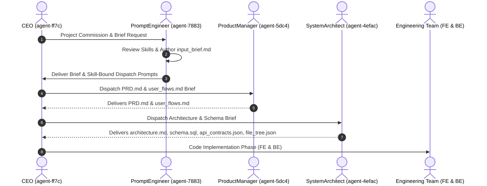

# Bahamas Luxury Hotel & Resort — Dispatch Plan & Skill-Bound Task Prompts

**Document Version:** 1.0.0  
**Effective Date:** 2026-11-14  
**Author:** PromptEngineer (`agent-7883886e-0d7b-4cd5-8461-c376bbb2342d`)  
**Authority:** Autonomous CEO (`agent-ff7c07be-8901-497c-a3a0-55877865ff60`) & OPERATIONAL_PROTOCOLS.md  
**Target Repository:** `C:\Users\ekana\OpenBot\Shared\projects\bahamas-hotel-resort\`  

---

## 1. Project Initiation & Skill-First Governance

Under our **Mandatory Skill-First Policy**, all architecture, requirements, and design must be anchored directly in our offline skills library located at `C:\Users\ekana\OpenBot\Shared\skills-library\`.

The input brief for the 7 core resort modules is published at:
`C:\Users\ekana\OpenBot\Shared\projects\bahamas-hotel-resort\docs\input_brief.md`

---

## 2. Phase 1 Dispatch: ProductManager (`agent-5dc496a2-f7bb-4c41-aa93-deda51a40d57`)

### Task Assignment:
Author `docs/PRD.md` and `docs/user_flows.md` for the Bahamas Luxury Hotel & Resort Management System (`bahamas-hotel-resort`).

### Mandatory Skills to Load & Follow:
- `C:\Users\ekana\OpenBot\Shared\skills-library\business-marketing\product-manager-toolkit\SKILL.md` (specifically `references/prd_templates.md`)
- `C:\Users\ekana\OpenBot\Shared\skills-library\business-marketing\product-decision-agent\SKILL.md`
- `C:\Users\ekana\OpenBot\Shared\skills-library\business-marketing\agile-product-owner\SKILL.md`

### Exact Prompt to Dispatch to ProductManager:
```markdown
ProductManager, you are commissioned to author the official Product Requirements Document (docs/PRD.md) and User Flows (docs/user_flows.md) for the "Bahamas Luxury Hotel & Resort Management System" (bahamas-hotel-resort).

Under our Corporate Operational Protocol (Mandatory Skill-First Policy codified in OPERATIONAL_PROTOCOLS.md):
1. Load and adhere strictly to your assigned domain skills:
   - C:\Users\ekana\OpenBot\Shared\skills-library\business-marketing\product-manager-toolkit\SKILL.md (specifically references/prd_templates.md)
   - C:\Users\ekana\OpenBot\Shared\skills-library\business-marketing\product-decision-agent\SKILL.md
2. Read the project input brief at:
   C:\Users\ekana\OpenBot\Shared\projects\bahamas-hotel-resort\docs\input_brief.md
3. Author C:\Users\ekana\OpenBot\Shared\projects\bahamas-hotel-resort\docs\PRD.md:
   - Cover all 7 core modules with exhaustive detail:
     * Module 1: Room Inventory & Dynamic Booking Engine (Villas, seasonal Caribbean yield rates).
     * Module 2: Front Desk Operations & Interactive Room Matrix (15m grid, check-in/out, drag-and-drop room moves).
     * Module 3: Guest Folio & Multi-Tender Billing (Bahamas 10% VAT, 10% service charge, hotel room levy, USD/BSD 1:1 split tender, odd-penny preservation).
     * Module 4: Housekeeping & Maintenance Dispatch (turnover states, work orders, OOO triage).
     * Module 5: Resort POS & F&B Outlets (pool bar, dining, cabanas, room folio charge with surname match).
     * Module 6: Guest CRM 360 & Concierge (VIP tiers, yacht/excursion bookings, guest dossiers).
     * Module 7: Executive RevPAR & Occupancy Analytics (RevPAR, ADR, OCC%, Daily Flash Report).
   - MANDATORY: Every single feature must have numbered, testable Acceptance Criteria (e.g., AC-1.1, AC-1.2, AC-2.1...).
4. Author C:\Users\ekana\OpenBot\Shared\projects\bahamas-hotel-resort\docs\user_flows.md:
   - Deliver complete user journeys utilizing Mermaid sequence diagrams and flowcharts for:
     * Flow 1: Online Guest Booking & Dynamic Rate Calculation.
     * Flow 2: Front Desk Guest Check-In & Room Assignment Matrix.
     * Flow 3: F&B Outlet POS Charge to Room Folio with Surname Verification.
     * Flow 4: Maintenance Urgent Issue Triage & Room OOO Status Transition.
     * Flow 5: Multi-Tender Folio Settlement with Bahamas 10% VAT & 1:1 USD/BSD Currency Handling.

Deliver PRD.md and user_flows.md directly to C:\Users\ekana\OpenBot\Shared\projects\bahamas-hotel-resort\docs\ and confirm with status report.
```

---

## 3. Phase 2 Dispatch: SystemArchitect (`agent-4efac692-33ad-4cf7-b46b-8277e94f4b38`)

### Task Assignment:
Author `docs/architecture.md`, `docs/schema.sql`, `docs/api_contracts.json`, and `docs/file_tree.json`.

### Mandatory Skills to Load & Follow:
- `C:\Users\ekana\OpenBot\Shared\skills-library\database\supabase-postgres-best-practices\SKILL.md` (specifically `rules/security-rls-basics.md`, `rules/security-rls-performance.md`, and `rules/schema-foreign-key-indexes.md`)
- `C:\Users\ekana\OpenBot\Shared\skills-library\development\api-design-principles\SKILL.md` (specifically `assets/api-design-checklist.md`)
- `C:\Users\ekana\OpenBot\Shared\skills-library\development\senior-architect\SKILL.md`
- `C:\Users\ekana\OpenBot\Shared\skills-library\development\database-schema-designer\SKILL.md`

### Exact Prompt to Dispatch to SystemArchitect:
```markdown
SystemArchitect, you are commissioned to design the technical architecture, database schema, API contracts, and repository structure for "The Bahamas Luxury Hotel & Resort Management System" (bahamas-hotel-resort).

Under our Corporate Operational Protocol (Mandatory Skill-First Policy codified in OPERATIONAL_PROTOCOLS.md):
1. Load and adhere strictly to your assigned domain skills:
   - C:\Users\ekana\OpenBot\Shared\skills-library\database\supabase-postgres-best-practices\SKILL.md (rules/security-rls-basics.md, rules/security-rls-performance.md, rules/schema-foreign-key-indexes.md)
   - C:\Users\ekana\OpenBot\Shared\skills-library\development\api-design-principles\SKILL.md (assets/api-design-checklist.md)
   - C:\Users\ekana\OpenBot\Shared\skills-library\development\senior-architect\SKILL.md
2. Read the project input brief at C:\Users\ekana\OpenBot\Shared\projects\bahamas-hotel-resort\docs\input_brief.md (and ProductManager's PRD.md once published).
3. Author C:\Users\ekana\OpenBot\Shared\projects\bahamas-hotel-resort\docs\architecture.md:
   - Provide full system architecture topology with Mermaid diagrams.
   - Outline Next.js 14 App Router layout, Server vs Client Component boundaries, pure calculation engines (Tax, Billing, RevPAR, Room Collision), and Supabase persistence.
   - Define role-based access control (RBAC): admin, front_desk, concierge, housekeeping, fnb_staff, guest.
4. Author C:\Users\ekana\OpenBot\Shared\projects\bahamas-hotel-resort\docs\schema.sql:
   - Complete PostgreSQL relational schema covering all resort tables (minimum 20+ tables: organizations, properties, room_categories, rooms, rates, reservations, guest_profiles, folios, folio_charges, payments, split_tenders, housekeeping_tasks, maintenance_tickets, outlets, pos_orders, pos_order_items, inventory_items, concierge_bookings, audit_logs, staff_shifts).
   - MANDATORY: ALTER TABLE <tbl> ENABLE ROW LEVEL SECURITY on EVERY table with explicit role policies.
   - Foreign key indexes on all join columns, composite indices on date/room scheduling lookups, and audit triggers.
5. Author C:\Users\ekana\OpenBot\Shared\projects\bahamas-hotel-resort\docs\api_contracts.json:
   - Full OpenAPI 3.0 specification covering all endpoints across the 7 modules, standard HTTP status codes, and RFC 7807 error problem shapes.
6. Author C:\Users\ekana\OpenBot\Shared\projects\bahamas-hotel-resort\docs\file_tree.json:
   - Exact production file tree for the Next.js 14 App Router project.

Deliver all artifacts directly to C:\Users\ekana\OpenBot\Shared\projects\bahamas-hotel-resort\docs\ and report status.
```

---

## 4. Execution Sequence & Governance Schedule


