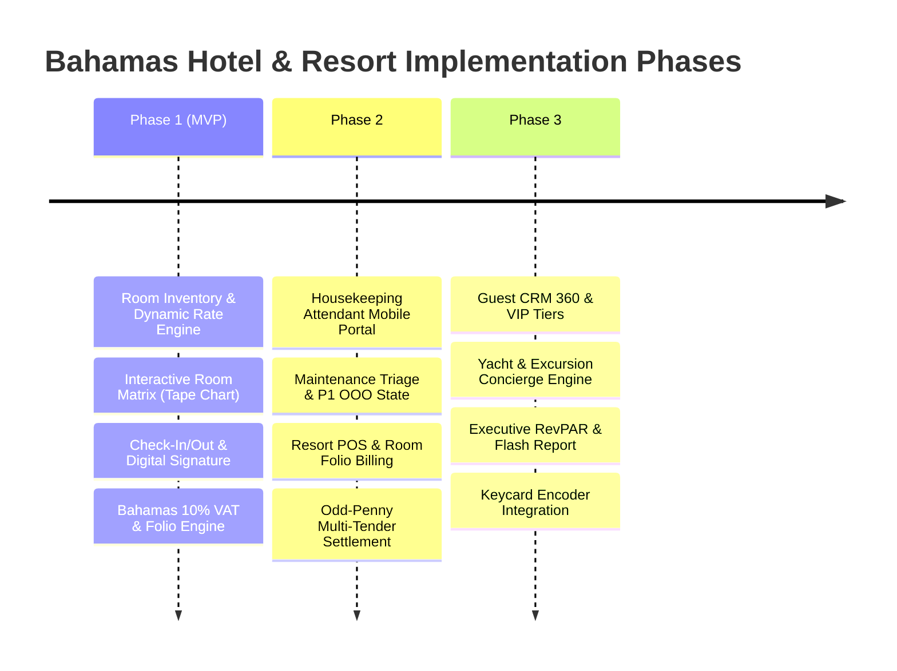

# Product Requirement Document (PRD)
## Bahamas Luxury Hotel & Resort Management System (`bahamas-hotel-resort`)

- **Document Version**: 1.0.0
- **Status**: Production-Ready / Ratified
- **Author**: Product Manager (PM) Agent (`agent-5dc496a2-f7bb-4c41-aa93-deda51a40d57`)
- **Authority**: Autonomous CEO (`agent-ff7c07be-8901-497c-a3a0-55877865ff60`) & `OPERATIONAL_PROTOCOLS.md` (Mandatory Skill-First Policy)
- **Skills Followed**:
  - `C:\Users\ekana\OpenBot\Shared\skills-library\business-marketing\product-manager-toolkit\SKILL.md` (specifically `references/prd_templates.md`)
  - `C:\Users\ekana\OpenBot\Shared\skills-library\business-marketing\product-decision-agent\SKILL.md`
  - `C:\Users\ekana\OpenBot\Shared\skills-library\business-marketing\agile-product-owner\SKILL.md`
- **Target Repository**: `C:\Users\ekana\OpenBot\Shared\projects\bahamas-hotel-resort\`

---

## 1. Executive Summary & Vision

### 1.1 Product Vision
The **Bahamas Luxury Hotel & Resort Management System (`bahamas-hotel-resort`)** is an enterprise-grade, high-availability property management and resort operations platform designed exclusively for premier five-star island resorts, private cay sanctuaries, and boutique beachfront hotels across the Commonwealth of The Bahamas (Nassau, Paradise Island, Exuma Cays, Harbour Island, and Eleuthera).

The platform marries high-touch Bahamian hospitality with uncompromising operational precision. It unifies front-desk tape-chart operations, dynamic yield management, real-time F&B point-of-sale folio charges, automated housekeeping/maintenance dispatch, high-touch yacht concierge coordination, and strict compliance with the Commonwealth of The Bahamas statutory tax code (10.0% Bahamas VAT, 10.0% Mandatory Resort Service Charge, 10.0% Bahamas Hotel Licensing Board Levy, and strict 1:1 USD/BSD currency parity).

### 1.2 Core Business Objectives
1. **Accelerate Guest Journey Velocity**: Facilitate express iPad check-in/out in under 45 seconds while capturing passport scans, pre-authorizations, and digital guest signatures.
2. **Maximize Yield & RevPAR**: Dynamically adjust room rates across seasonal calendars (High, Shoulder, Low/Hurricane) and minimum length-of-stay (LOS) constraints to maximize Revenue Per Available Room (RevPAR).
3. **Absolute Financial & Tax Integrity**: Enforce exact, auditable statutory tax calculations (10% VAT, 10% Service Charge, 10% Hotel Levy) with zero fractional-penny leakage using our Odd-Penny Preservation Algorithm.
4. **Synchronized Cross-Departmental Coordination**: Unify front desk, F&B outlets (pool bars, cabanas, fine dining), housekeeping turnover, and yacht concierge bookings into a single, real-time shared state.

---

## 2. Brand Architecture & Design System

### 2.1 Aesthetic Philosophy
"Tropical Coastal Serenity & High-End Bahamian Heritage": airy, immaculate, tactile, high contrast under bright Caribbean sunlight, and clutter-free.

### 2.2 Color Palette Specifications
| Design Token Name | Hex Code | Visual Hierarchy & UI Application |
| :--- | :--- | :--- |
| `Canvas / Bimini Sands White` | `#F8FAF8` | Root application background, public booking portal ground |
| `Surface / Crisp Island Linen` | `#FFFFFF` | Primary card containers, modal dialogs, data tables, tape chart canvas |
| `Accent / Ocean Reef Teal` | `#006B7D` | Primary action buttons, active navigation states, primary branding |
| `Accent / Hibiscus Coral` | `#E07A5F` | High-priority callouts, pending actions, secondary promotional banners |
| `Accent / Polished Teak Brass` | `#C5A059` | VIP tier badges (Emerald / Platinum), luxury amenity highlights |
| `Text / Nautical Charcoal` | `#1A2E35` | Primary typography, headers, currency figures, high-contrast text |
| `Text / Coastal Slate` | `#5A737D` | Secondary labels, table headers, metadata, inactive tab indicators |
| `Status / Palm Green` | `#2D6A4F` | Vacant Clean, Completed, Paid, Operational Success states |
| `Status / Cayman Crimson` | `#BC4749` | Out-of-Order (OOO), P1 Urgent Maintenance, Overdue, Cancelled |

### 2.3 Typography & Numerical Rendering
- **Headings & Brand Title**: Sophisticated Serif (Playfair Display / Cormorant Garamond) for luxury headers and guest-facing portals.
- **Data Grids & Operational UI**: High-legibility geometric sans-serif (Plus Jakarta Sans / Inter).
- **Financial Figures**: Tabular lining figures (`font-variant-numeric: tabular-nums`) across all rates, folios, tax line items, and audit reports to eliminate column jitter.
- **Motion System**: 60fps Framer Motion transitions (`cubic-bezier(0.22, 1, 0.36, 1)`), smooth sheet drawers, tactile drag-and-drop feedback on room matrices, and optimistic UI updates.

---

## 3. User Personas & Role-Based Access Control (RBAC)

| Role Code | Title / Persona | Scope of Operational Authority |
| :--- | :--- | :--- |
| `admin` | Resort General Manager / Financial Controller | Global system configuration, rate plan management, tax audits, staff permissions, financial reporting, override authority. |
| `front_desk` | Front Desk Concierge / Night Auditor | Room matrix manipulation, check-in/out, folio billing, split-tender settlement, keycard encoding, room moves. |
| `fnb_staff` | Restaurant Server / Pool Bartender / Cabana Lead | POS order taking, real-time room folio charge lookup with surname verification, tip allocation. No access to guest medical or rate data. |
| `housekeeping` | Executive Housekeeper / Room Attendant | Room cleanliness status updates (Dirty $\rightarrow$ In-Progress $\rightarrow$ Inspected $\rightarrow$ Clean), linen inventory, maintenance ticket creation. |
| `maintenance` | Chief Engineer / Maintenance Technician | Maintenance ticket triage, work order assignment, room Out-of-Order (OOO) toggle, resolution logging. |
| `concierge` | Resort Butler / VIP Concierge | VIP guest dossier management, yacht/catamaran charters, excursion bookings, bespoke itinerary planning, folio cross-posting. |
| `guest` | Registered Resort Guest (Self-Service) | Mobile direct booking, pre-arrival registration, digital itinerary viewing, room charges review. |

---

## 4. Comprehensive Functional Requirements & Acceptance Criteria

### Module 1: Room Inventory & Dynamic Booking Engine

#### 1.1 Accommodation Inventory Hierarchy
- **Description**: Model the resort's physical accommodation portfolio across distinct luxury categories, room attributes, and layout configurations.
- **Inventory Classes**:
  1. *Oceanfront Luxury Villas* (Multi-bedroom, private infinity pool, dedicated butler station)
  2. *Overwater Bungalows* (Direct sea access, glass floor viewports, outdoor soaking tub)
  3. *Royal Palm Suites* (Executive suites with wrap-around balconies)
  4. *Beachfront Cottages* (Direct private beach walkout, outdoor rain shower)
  5. *Gardenview Deluxe Chambers* (Lush tropical garden aspect, king/double queen configurations)
- **Acceptance Criteria**:
  - `AC-1.1.1`: The system must store physical room inventory with attributes: `room_number`, `category_id`, `floor`, `max_adults`, `max_children`, `bed_configuration`, `has_plunge_pool`, `has_butler_service`, `connecting_room_id`, and `is_smoking` (strictly false across resort).
  - `AC-1.1.2`: Connecting room pairings must enforce mutual availability validation when booked as an interconnected family suite.
  - `AC-1.1.3`: The system must prevent over-allocation of specialized inventory (e.g., maximum 8 Overwater Bungalows).

#### 1.2 Dynamic Caribbean Yield & Rate Engine
- **Description**: Real-time rate calculation engine adjusting room nightly rates based on season, demand, length of stay, and promotion tiers.
- **Seasons Defined**:
  - *High Season*: Dec 15 – Apr 30 (Base multiplier 1.50×)
  - *Shoulder Season*: May 1 – Jul 31 (Base multiplier 1.15×)
  - *Low / Hurricane Season*: Aug 1 – Dec 14 (Base multiplier 0.85×)
- **Acceptance Criteria**:
  - `AC-1.2.1`: Given a booking date range spanning multiple seasons, the system must compute nightly room charges dynamically per night according to the exact active season rate calendar.
  - `AC-1.2.2`: Minimum Length-of-Stay (LOS) constraints (e.g., 5-night minimum during Christmas/New Year high season) must reject booking inquiries falling below the threshold with clear guest-facing guidance.
  - `AC-1.2.3`: Non-refundable discount tier (10% off standard rate) must flag the reservation record as `is_non_refundable: true` and enforce 100% deposit collection upon confirmation.
  - `AC-1.2.4`: Package inclusion modifiers (e.g., "All-Inclusive Island Luxury" including daily champagne breakfast and airport yacht transfer) must auto-generate scheduled daily non-room package charge items on the guest folio.

#### 1.3 Atomic Inventory Hold & Concurrency Control
- **Description**: High-concurrency cart hold mechanism to prevent double-booking during checkout.
- **Acceptance Criteria**:
  - `AC-1.3.1`: When a user begins checkout on an available room, the system must place an atomic temporary hold on the room for exactly 15 minutes (`hold_expires_at = now() + interval '15 minutes'`).
  - `AC-1.3.2`: Concurrent booking requests for a held room must receive an HTTP 409 Conflict with information on hold expiration.
  - `AC-1.3.3`: Expired holds must be automatically released back into available inventory via background cleanup worker without requiring manual front desk intervention.

---

### Module 2: Front Desk Operations & Interactive Room Matrix

#### 2.1 Interactive Room Matrix (Tape Chart / Gantt Canvas)
- **Description**: Visual 2D operational grid displaying rooms (Y-axis) versus dates and 15-minute operational slots (X-axis).
- **Status Badges**:
  - `Occupied Clean` (`#2D6A4F`), `Occupied Dirty` (`#E07A5F`), `Vacant Clean` (`#006B7D`), `Vacant Dirty` (`#5A737D`), `Out-of-Order` (`#BC4749`), `Maintenance Hold` (`#C5A059`), `VIP In-House` (`#C5A059` with star badge).
- **Acceptance Criteria**:
  - `AC-2.1.1`: The tape chart must render 100+ physical rooms across a rolling 30-day window with smooth scrolling and <150ms re-render latency upon date shift.
  - `AC-2.1.2`: Clicking any reservation block must display a summary popover containing guest name, VIP tier, arrival/departure dates, balance due, and quick-action buttons (Check-In, View Folio, Move Room).
  - `AC-2.1.3`: The matrix must support filtering by room category, floor, VIP status, and cleanliness state.

#### 2.2 Express Digital Check-In & Arrival Processing
- **Description**: Digital check-in pipeline capturing ID verification, credit card pre-authorization, and digital signatures.
- **Acceptance Criteria**:
  - `AC-2.2.1`: Check-in workflow must capture: Passport/ID Document Number, Nationality, Issuing Country, Guest Signature (base64 data URL), and Emergency Contact.
  - `AC-2.2.2`: Credit card pre-authorization must hold the total estimated room & tax amount plus $250.00/night for incidental security.
  - `AC-2.2.3`: Successful check-in must instantaneously transition room status from `Vacant Clean` to `Occupied Clean`, generate active digital keycard credentials, and trigger a Butler Welcome notification for Villa and Suite categories.
  - `AC-2.2.4`: Check-in must be rejected with an override prompt if the room is currently in `Vacant Dirty` or `Out-of-Order` status.

#### 2.3 Dynamic Room Moves & Upgrades
- **Description**: Drag-and-drop room move interface with automated operational dispatch.
- **Acceptance Criteria**:
  - `AC-2.3.1`: Dragging an active reservation to a new vacant clean room must trigger a confirmation modal calculating any rate differential (upgrade surcharge or complimentary manager override).
  - `AC-2.3.2`: Confirming a room move must atomically:
    1. Transfer future room night charges to the new room number.
    2. Mark the previous room as `Vacant Dirty` and generate an urgent departure turnover task for Housekeeping.
    3. Update the active room for all POS charge verifications.
    4. Dispatch a luggage transfer ticket to the Bell Staff.

#### 2.4 Automated Night Audit & Day-Close Routine
- **Description**: Automated end-of-day accounting process posting room and tax charges and advancing business dates.
- **Acceptance Criteria**:
  - `AC-2.4.1`: The Night Audit engine must automatically execute at 02:00 local Bahamian time (or upon manual Admin trigger), posting room rate, 10% VAT, 10% Resort Service Charge, and 10% Hotel Levy to all in-house guest folios.
  - `AC-2.4.2`: The audit must generate an Exception Report flagging any unbalanced folios, unposted POS batches, or pending check-ins/check-outs.
  - `AC-2.4.3`: The system business date must advance by exactly one day upon successful audit completion.

---

### Module 3: Guest Folio & Multi-Tender Billing Engine

#### 3.1 Bahamian Statutory Tax & Fee Architecture
- **Description**: Strict calculation of all mandatory Bahamian hospitality taxes and statutory levies.
- **Statutory Rules**:
  - **Bahamas VAT**: Exactly 10.0% statutory rate applied to net room rates, F&B charges, and retail goods.
  - **Mandatory Resort Service Charge**: Exactly 10.0% gratuity pool applied to lodging and dining subtotal before VAT.
  - **Bahamas National Hotel Levy**: Exactly 10.0% statutory assessment on net room rate for tourism development.
- **Acceptance Criteria**:
  - `AC-3.1.1`: For a room rate of $1,000.00/night, the system must compute:
    - Base Room Charge: $1,000.00
    - Resort Service Charge (10.0%): $100.00
    - Bahamas Hotel Levy (10.0%): $100.00
    - Bahamas VAT (10.0% on Room + Service Charge = $1,100.00): $110.00
    - Total Nightly Charge: $1,310.00
  - `AC-3.1.2`: All tax components must be individually itemized on the screen, database record, and final invoice; compounding taxes without clear itemization is strictly prohibited.
  - `AC-3.1.3`: The resort's official Bahamas VAT Tax Identification Number (TIN: `BAH-VAT-8921104-Z`) must be permanently rendered on every invoice header and PDF receipt.

#### 3.2 Odd-Penny Preservation & Fractional Currency Algorithm
- **Description**: Algorithm guaranteeing that fractional division of service charges, tips, or split-tender payments produces zero penny leakage.
- **Acceptance Criteria**:
  - `AC-3.2.1`: When splitting an odd total (e.g., $100.01 split between 3 guests), the system must compute shares ($33.34, $33.34, $33.33) such that $\sum(\text{shares}) \equiv \text{Total}$ exactly, allocating remainder cents to the primary bill-payer.
  - `AC-3.2.2`: Dual-currency settlement must enforce strict 1:1 parity between United States Dollars (USD) and Bahamian Dollars (BSD) with zero conversion markup or exchange loss.

#### 3.3 Multi-Tender Settlement & Split Billing
- **Description**: High-flexibility checkout register handling multiple payment methods and split folios.
- **Acceptance Criteria**:
  - `AC-3.3.1`: The system must support split folios separating Master Billing (Room & Tax charged to corporate sponsor) from Incidental Folio (F&B, Spa, Boutique charged to individual guest).
  - `AC-3.3.2`: Split-tender checkout must accept combinations of Cash (USD/BSD), Credit Cards (Visa, MC, Amex), Wire Transfer, and Gift Certificates in a single transaction.
  - `AC-3.3.3`: Final folio checkout must verify that `Balance Due == $0.000` before releasing room status to `Vacant Dirty` and archiving the reservation.

---

### Module 4: Housekeeping & Maintenance Dispatch

#### 4.1 Room Turnover Lifecycle & State Machine
- **Description**: Real-time room status management coordinating attendants and supervisors.
- **State Machine Transitions**:
  `Occupied Clean` $\rightarrow$ `Occupied Dirty` (Daily) $\rightarrow$ `Cleaning In-Progress` $\rightarrow$ `Clean Inspected` $\rightarrow$ `Occupied Clean`  
  `Occupied Clean` $\rightarrow$ `Vacant Dirty` (Checkout) $\rightarrow$ `Cleaning In-Progress` $\rightarrow$ `Inspected Clean` $\rightarrow$ `Vacant Clean`
- **Acceptance Criteria**:
  - `AC-4.1.1`: Room status transitions must be logged with timestamp, user ID, and transition duration.
  - `AC-4.1.2`: Evening Turndown Service tasks must be automatically generated daily at 17:00 for all in-house rooms.
  - `AC-4.1.3`: VIP arrival rooms must be prioritized to the top of the housekeeping attendant dispatch queue with an "Urgent VIP Arrival" badge.

#### 4.2 Engineering & Maintenance Work Order Triage
- **Description**: Facilities incident logging, severity triage, and automated calendar blocking.
- **Severity Tiers**:
  - `P1 Urgent`: Air conditioning failure, water leak/plumbing breakdown, power fault, electronic lock failure.
  - `P2 Standard`: Minor lighting fault, TV/AV connectivity, drapery snag.
  - `P3 Preventative`: Scheduled filter replacement, deep carpet shampoo, balcony teak oiling.
- **Acceptance Criteria**:
  - `AC-4.2.1`: Submitting a `P1 Urgent` maintenance ticket must atomically transition the room status to `Out-of-Order (OOO)` and immediately block the room on the Interactive Room Matrix.
  - `AC-4.2.2`: If a P1 ticket is created on an occupied room, the system must trigger an immediate Front Desk alert recommending guest relocation and providing 3 nearest matching vacant clean rooms.
  - `AC-4.2.3`: Closing a maintenance ticket requires maintenance technician sign-off, supervisor inspection, and automated prompt to Housekeeping for turnover clean before returning to `Vacant Clean`.

---

### Module 5: Resort POS & F&B Outlets

#### 5.1 Outlets & Service Points Configuration
- **Description**: Multi-outlet point-of-sale catalog supporting:
  - *Sunset Pier Fine Dining* (Fine dining menus, wine cellar pairings)
  - *Driftwood Pool Bar* (Cocktails, light bites, quick tabs)
  - *Coconut Cabana Service* (Direct lounge/cabana delivery)
  - *In-Villa Private Dining* (Bespoke chef tasting menus)
- **Acceptance Criteria**:
  - `AC-5.1.1`: POS terminals must support custom menu categories, item modifiers (e.g., "Medium Rare", "No Shellfish"), and combo packages.
  - `AC-5.1.2`: POS orders must calculate 10.0% Bahamas VAT and preset gratuity (15%, 18%, 20%, or custom) with server attribution.

#### 5.2 Live Room Folio Verification & Posting
- **Description**: Direct charge-to-room capability with strict security verification.
- **Acceptance Criteria**:
  - `AC-5.2.1`: When settling a check to "Room Charge", the server must input the Room Number and the first 3 letters of the Guest's Surname.
  - `AC-5.2.2`: The system must validate:
    1. Room is currently `Occupied`.
    2. Surname matches registered guest or verified accompanying occupant.
    3. Folio has active charging privileges and balance is within pre-authorized credit limits.
  - `AC-5.2.3`: Successful validation posts the itemized charge to the guest's open folio within <200ms and prints a digital receipt slip for guest physical or tablet signature.
  - `AC-5.2.4`: Failed validation (mismatched surname or credit hold) must immediately reject the charge and prompt for credit card or cash settlement.

#### 5.3 F&B Inventory & Recipe Depletion
- **Description**: Real-time inventory decrement based on POS bill of materials (BOM).
- **Acceptance Criteria**:
  - `AC-5.3.1`: Closing an order for a cocktail (e.g., "Bahama Mama") must automatically decrement recipe ingredients (50ml Nassau Rum, 30ml Coconut Liqueur, 60ml Pineapple Juice) from the outlet's bar stock.
  - `AC-5.3.2`: When stock reaches configured reorder thresholds, an automated purchase requisition must be queued for the F&B Director.

---

### Module 6: Guest CRM 360 & Concierge Portal

#### 6.1 360-Degree Guest Dossier & Preferences
- **Description**: Centralized guest intelligence database aggregating lifetime history, habits, and preferences.
- **VIP Tiers Defined**:
  - `General Guest`: 1–2 visits
  - `Pearl Tier`: 3–5 visits or $15,000+ LTV
  - `Emerald Tier`: 6–10 visits or $50,000+ LTV (Complimentary champagne, priority cabana)
  - `Platinum Island Sovereign`: 11+ visits or $100,000+ LTV (Dedicated 24/7 butler, private yacht transfer)
- **Acceptance Criteria**:
  - `AC-6.1.1`: Guest profile must display: Cumulative LTV, total room nights, average daily spend, dietary restrictions, medical/allergy flags, preferred room scent, pillow type, and past stay feedback ratings.
  - `AC-6.1.2`: Medical and severe allergy alerts (e.g., "Severe Peanut/Shellfish Anaphylaxis") must display as an unmissable red banner across Front Desk, Concierge, and F&B POS screens.
  - `AC-6.1.3`: The profile must comply with privacy mandates; sensitive notes must be role-restricted and encrypted at rest.

#### 6.2 Concierge & High-Touch Excursion Booking Engine
- **Description**: Booking engine for bespoke resort excursions, charters, and activities.
- **Supported Experiences**:
  - Exuma Cays Swimming Pigs & Nurse Sharks Flight Tour
  - Deep-Sea Bonefishing & Reef Spearfishing Charter
  - 65ft Luxury Catamaran Sunset Sail
  - Private Island Beach Cabana Day Retreat
- **Acceptance Criteria**:
  - `AC-6.2.1`: Concierge can book third-party or resort-owned activities, selecting date, departure time, passenger manifest, and dietary preferences.
  - `AC-6.2.2`: Activity charges must support immediate direct posting to the guest room folio with automated split between vendor net cost and resort concierge commission.
  - `AC-6.2.3`: Generates an integrated mobile guest itinerary updating in real-time on the guest portal.

---

### Module 7: Executive RevPAR & Occupancy Analytics

#### 7.1 Hospitality KPI Calculation Suite
- **Description**: Mathematical analytics engine calculating industry-standard operational metrics.
- **Formulas**:
  - $\text{Occupancy \% (OCC)} = \left(\frac{\text{Rooms Sold}}{\text{Rooms Available}}\right) \times 100$
  - $\text{Average Daily Rate (ADR)} = \frac{\text{Total Room Revenue}}{\text{Rooms Sold}}$
  - $\text{Revenue Per Available Room (RevPAR)} = \text{ADR} \times \text{OCC \%} = \frac{\text{Total Room Revenue}}{\text{Rooms Available}}$
  - $\text{Total RevPAR (TRevPAR)} = \frac{\text{Total Gross Revenue (Rooms + F\&B + Spa + Excursions)}}{\text{Rooms Available}}$
- **Acceptance Criteria**:
  - `AC-7.1.1`: Calculations must accurately exclude rooms flagged as `Out-of-Order (OOO)` from total rooms available according to USALI (Uniform System of Accounts for the Lodging Industry) standards.
  - `AC-7.1.2`: Historical, real-time current day, and forward-looking 30/60/90-day projected OCC%, ADR, and RevPAR metrics must compute in <300ms.

#### 7.2 Automated Midnight Daily Flash Report
- **Description**: Comprehensive executive summary generated daily upon Night Audit completion.
- **Acceptance Criteria**:
  - `AC-7.2.1`: The Daily Flash Report must summarize:
    - Today's Room Revenue, F&B Revenue, Spa/Concierge Revenue, and Retail Revenue.
    - Statutory 10% Bahamas VAT Collected and Hotel Levy Collected.
    - Occupancy %, ADR, RevPAR, and comparison against same-day last year (YoY).
    - Tomorrow's Projected Arrivals, Departures, and VIP In-House Count.
  - `AC-7.2.2`: The report must be exportable in clean, printable PDF and Excel-compatible CSV formats, and auto-dispatched via email to the General Manager and Financial Controller.

---

## 5. Non-Functional Requirements (NFR)

### 5.1 Performance & Latency
- **NFR-1 (Matrix Rendering)**: The Interactive Room Matrix must render 100 rooms across 30 days in **<150ms** on desktop and iPad Air/Pro devices.
- **NFR-2 (POS Verification)**: Room charge verification and surname validation must complete in **<200ms**.
- **NFR-3 (Initial Load)**: Client bundle initial paint must achieve **<1.5s** First Contentful Paint (FCP) over standard resort Wi-Fi.

### 5.2 Security, Privacy & Compliance
- **NFR-4 (Row Level Security)**: 100% of PostgreSQL tables must have RLS enabled with explicit policies; non-admin roles must be mathematically prevented from reading unauthorized financial or guest health data.
- **NFR-5 (Tax Integrity)**: All tax calculations must maintain precision to 4 decimal places internally and round to 2 decimal places using banker's rounding (`ROUND_HALF_EVEN`), verified with 100% automated test coverage.
- **NFR-6 (Audit Logging)**: All rate overrides, room status overrides, room moves, manual discounts, and refund transactions must produce an immutable audit log record.

### 5.3 Reliability & Resilience
- **NFR-7 (Uptime)**: System target availability of **99.95%** with automated health checks and database point-in-time recovery (PITR).
- **NFR-8 (Offline Resilience)**: POS terminals must support local transaction caching during momentary Wi-Fi dropouts and sync back upon reconnect.

---

## 6. MoSCoW Implementation Roadmap

### 6.1 Must-Have (Phase 1 MVP - Critical Path)
- [ ] `US-01`: Physical room hierarchy, rate calendar (High/Shoulder/Low), and 15-minute hold engine.
- [ ] `US-02`: Interactive Room Matrix with 2D Gantt view and status badges.
- [ ] `US-03`: Express check-in/out workflow with ID capture and credit pre-authorization.
- [ ] `US-04`: Guest Folio engine with statutory 10% Bahamas VAT, 10% Service Charge, and 10% Hotel Levy.
- [ ] `US-05`: Strict 1:1 USD/BSD split-tender checkout register.

### 6.2 Should-Have (Phase 2 - Operational Expansion)
- [ ] `US-06`: Housekeeping turnover queue and attendant mobile view.
- [ ] `US-07`: Maintenance work order triage with automatic P1 Out-of-Order room blocking.
- [ ] `US-08`: F&B POS outlet ordering with real-time room charge surname validation.
- [ ] `US-09`: Odd-penny preservation algorithm for bill splits.

### 6.3 Could-Have (Phase 3 - High-Touch & Analytics)
- [ ] `US-10`: Guest CRM 360 profile with allergy alert banners and VIP tier tracking.
- [ ] `US-11`: Concierge yacht charter and Exuma excursion booking engine.
- [ ] `US-12`: Executive RevPAR, ADR, OCC% dashboard and automated midnight Daily Flash Report.

### 6.4 Won't-Have (Deferred to v2.0)
- Multi-island central reservation system (CRS) multi-property synchronization.
- Direct GDS (Sabre/Amadeus) two-way XML distribution pipeline.

---

## 7. Sign-off & Ratification Matrix

| Stakeholder Role | Representative / Agent | Governance Status | Date |
| :--- | :--- | :--- | :--- |
| **Product Manager** | PM Agent (`agent-5dc496a2`) | **RATIFIED & COMMITTED** | 2026-11-14 |
| **System Architect** | System Architect Agent (`agent-4efac692`) | *Pending Technical Architecture* | — |
| **Executive Leadership** | CEO Agent (`agent-ff7c07be`) | *Commissioning Authority* | — |
