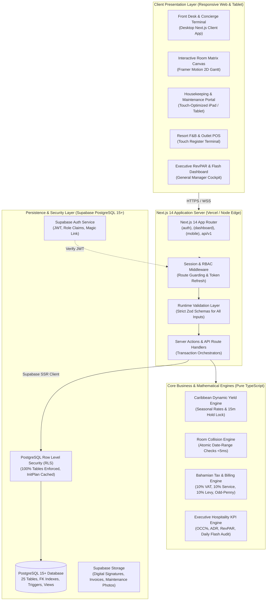
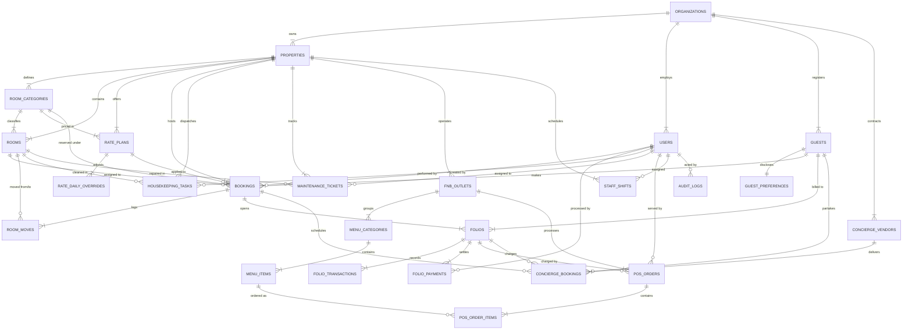

# System Architecture & Technical Specifications
## Bahamas Luxury Hotel & Resort Management System (`bahamas-hotel-resort`)

- **Document Version**: 1.0.0
- **Status**: Production-Ready / Ratified
- **System Architect**: System Architect Agent (`agent-4efac692`)
- **Authority**: CEO Directive / Mandatory Skill-First Governance
- **Mandatory Skills Applied**:
  - `supabase-postgres-best-practices` (InitPlan subquery caching & composite indexing)
  - `api-design-principles` (RESTful resource design & RFC 7807 problem details)
  - `senior-architect` (Component boundaries & state flow)
  - `database-schema-designer` (3NF relational modeling & constraint design)
- **Companion Deliverables**:
  - Input Brief: [input_brief.md](file:///C:/Users/ekana/OpenBot/Shared/projects/bahamas-hotel-resort/docs/input_brief.md)
  - Dispatch Plan: [DISPATCH_PLAN_AND_TASK_PROMPTS.md](file:///C:/Users/ekana/OpenBot/Shared/projects/bahamas-hotel-resort/docs/DISPATCH_PLAN_AND_TASK_PROMPTS.md)
  - Database Schema: [schema.sql](file:///C:/Users/ekana/OpenBot/Shared/projects/bahamas-hotel-resort/docs/schema.sql)
  - API Contracts: [api_contracts.json](file:///C:/Users/ekana/OpenBot/Shared/projects/bahamas-hotel-resort/docs/api_contracts.json)
  - File Hierarchy: [file_tree.json](file:///C:/Users/ekana/OpenBot/Shared/projects/bahamas-hotel-resort/docs/file_tree.json)

---

## 1. Executive Architecture Overview

### 1.1 System Vision & Operational Scope
The **Bahamas Luxury Hotel & Resort Management System (`bahamas-hotel-resort`)** is a next-generation, high-availability property management and resort operations platform purpose-built for five-star island resorts, private cay retreats, and boutique beachfront hotels across the Commonwealth of The Bahamas (e.g., Cable Beach, Paradise Island, Exuma Cays, Harbour Island, and Eleuthera).

The platform bridges world-class Bahamian hospitality and guest personalization with rigorous operational efficiency, financial compliance under Bahamian tax laws, and real-time cross-departmental coordination:
1. **Interactive Room Matrix (Tape Chart / Gantt Canvas)**: Real-time visual 2D accommodation canvas tracking live room states (Occupied Clean, Occupied Dirty, Vacant Clean, Vacant Dirty, Out-of-Order, Maintenance Hold, VIP In-House) with drag-and-drop room move dispatch.
2. **Dynamic Caribbean Yield Engine**: Multi-seasonal rate management (High Season, Shoulder Season, Low/Hurricane Season), Length-of-Stay (LOS) minimums, and atomic 15-minute checkout cart locking to prevent concurrent double-booking.
3. **Bahamian Statutory Tax & Multi-Tender Billing Engine**: Full statutory compliance with the Bahamas Value Added Tax Act (10.0% VAT), Mandatory Resort Service Charge (10.0%), and Bahamas National Hotel Levy (10.0%), accompanied by strict USD/BSD 1:1 currency parity and an **Odd-Penny Preservation Algorithm** ensuring zero cent leakage across split-tender settlements.
4. **Instant Room Folio Verification**: Seamless F&B and Concierge POS integration enforcing mandatory room number and guest surname verification before charge routing.
5. **Real-Time Housekeeping & Maintenance Dispatch**: Attendant mobile tablet queue with live turnover toggles and automated Out-of-Order (OOO) room status transitions upon submission of P1 Urgent engineering tickets.
6. **Executive RevPAR & Midnight Audit Cockpit**: Automated calculation engine generating daily Flash Reports (Occupancy %, ADR, RevPAR, TRevPAR, and department-level labor ratios).

---

### 1.2 High-Level Architecture Topology



---

### 1.3 Technology Stack Decisions & Rationale

| Layer | Technology | Decision Rationale |
| :--- | :--- | :--- |
| **Framework** | **Next.js 14 App Router** | Hybrid architecture utilizing React Server Components (RSC) for instantaneous initial data hydration and Client Component leaves for interactive 60fps canvas dragging. |
| **Language** | **TypeScript 5.x (Strict Mode)** | Complete end-to-end typing guaranteeing zero runtime type errors across complex financial ledgers, date ranges, and API payloads. |
| **Styling** | **Tailwind CSS 3.4** | Zero-runtime CSS engine with custom Bahamian luxury palette tokens (`#F8FAF8`, `#006B7D`, `#E07A5F`, `#C5A059`, `#1A2E35`). |
| **UI Primitives** | **Radix UI & Lucide Icons** | WAI-ARIA compliant accessible dialogs, popovers, tabs, and tooltips with luxury iconography. |
| **Micro-Interactions**| **Framer Motion 11** | Silky cubic-bezier easing (`[0.22, 1, 0.36, 1]`) providing smooth room tape-chart panning and drawer reveals without UI thread blocking. |
| **Database & Auth** | **PostgreSQL 15+ via Supabase** | High-availability ACID relational database, automated daily backups with Point-In-Time Recovery (PITR), and native Row Level Security. |
| **Validation** | **Zod 3.x** | Strict runtime schema enforcement on every incoming HTTP request body, query parameter, and server action. |

---

## 2. Component & Layer Architecture

### 2.1 Layer Separation
The application enforces strict separation of concerns across four discrete tiers:
1. **Presentation Layer (`src/components/`, `src/app/`)**:
   - Server Components for layout structure and initial server-side data pre-fetching.
   - Client Components (`"use client"`) for stateful surfaces: interactive room matrix canvas, active POS cart, split-tender checkout modal, and mobile room status toggles.
2. **Business Engine Layer (`src/lib/math/`, `src/lib/validators/`)**:
   - Pure, stateless TypeScript functions executing calculations: statutory tax and levy splits, odd-penny preservation, booking overlap detection, and RevPAR KPI derivation.
3. **Data Access & API Layer (`src/app/api/v1/`, `src/lib/supabase/`)**:
   - Next.js Route Handlers enforcing authentication, RBAC authorization, and invoking database stored procedures (`check_room_booking_collision`, `get_daily_flash_report`).
4. **Database & Persistence Layer (`supabase/migrations/`, `docs/schema.sql`)**:
   - PostgreSQL 15+ schema with 25 tables, primary/foreign key constraints, check constraints, composite B-tree indexes, stored procedures, and 100% RLS policies.

---

## 3. Data Architecture & Entity-Relationship (ER) Model

### 3.1 25-Table Entity-Relationship Diagram (Mermaid)



---

### 3.2 Master Entity Dictionary (25 Tables)

| # | Table Name | Primary Key | Key Foreign Keys | Purpose & Operational Function |
|---|:---|:---|:---|:---|
| 1 | `organizations` | `id` (UUID) | — | Multi-tenant root entity capturing resort enterprise name and official Bahamas VAT TIN. |
| 2 | `properties` | `id` (UUID) | `organizations(id)` | Physical resort property (e.g. Cable Beach, Paradise Island) with total rooms and island metadata. |
| 3 | `users` | `id` (UUID) | `auth.users(id)`, `organizations`, `properties` | Staff profiles capturing role, full name, email, phone, and active status. |
| 4 | `room_categories` | `id` (UUID) | `properties(id)` | Room tiers (Villas, Bungalows, Suites, Cottages, Deluxe) with occupancy limits and butler tiers. |
| 5 | `rooms` | `id` (UUID) | `properties(id)`, `room_categories(id)` | Physical inventory tracking room number, building, status, bed configuration, and keycard RFID UID. |
| 6 | `rate_plans` | `id` (UUID) | `properties(id)`, `room_categories(id)` | Dynamic Caribbean yield rates (High, Shoulder, Low seasons) with LOS minimums and 1:1 USD/BSD parity. |
| 7 | `rate_daily_overrides` | `id` (UUID) | `rate_plans(id)` | Date-specific rate yield adjustments and closed-to-arrival rules. |
| 8 | `guests` | `id` (UUID) | `organizations(id)` | 360-degree guest CRM tracking contact info, passport numbers, VIP tiers, and cumulative LTV spend. |
| 9 | `guest_preferences` | `id` (UUID) | `guests(id)` | Guest dossier: dietary restrictions, medical/allergy flags, preferred champagne, and pillow preferences. |
| 10 | `bookings` | `id` (UUID) | `properties`, `guests`, `rooms`, `categories`, `rates` | Central reservation lifecycle: confirmation number, check-in/out dates, status, and 15m hold locking. |
| 11 | `room_moves` | `id` (UUID) | `bookings`, `rooms(from/to)`, `users` | Historical audit of accommodation transfers, reason logging, and luggage dispatch. |
| 12 | `folios` | `id` (UUID) | `bookings(id)`, `guests(id)` | Guest billing ledger (room master, personal incidentals, corporate billing) with live balance tracking. |
| 13 | `folio_transactions` | `id` (UUID) | `folios(id)`, `users(posted_by)` | Itemized charges itemizing Bahamas 10% VAT, 10% Service Charge, and 10% Hotel Levy. |
| 14 | `folio_payments` | `id` (UUID) | `folios(id)`, `users(processed_by)` | Multi-tender settlements: Cash USD/BSD, credit cards, wire transfers, with odd-penny preservation. |
| 15 | `housekeeping_tasks` | `id` (UUID) | `properties`, `rooms`, `users(assigned/inspected)` | Real-time cleaning queues: Departure clean, stayover refresh, turndown, with priority ranking. |
| 16 | `maintenance_tickets` | `id` (UUID) | `properties`, `rooms`, `users(reported/assigned)` | Engineering work orders: category, severity (P1 urgent triggers room out-of-order), photos, resolution. |
| 17 | `fnb_outlets` | `id` (UUID) | `properties(id)` | Resort dining venues, bars, and beach cabanas with operating hours. |
| 18 | `menu_categories` | `id` (UUID) | `fnb_outlets(id)` | Menu groupings (Degustation, Cocktails, In-Villa Dining). |
| 19 | `menu_items` | `id` (UUID) | `menu_categories(id)` | Individual dishes and beverages with dual-currency pricing and taxability flags. |
| 20 | `pos_orders` | `id` (UUID) | `fnb_outlets`, `folios`, `users(server)` | F&B checks with room folio routing and mandatory guest surname verification. |
| 21 | `pos_order_items` | `id` (UUID) | `pos_orders(id)`, `menu_items(id)` | Line items for restaurant checks detailing quantity and unit prices. |
| 22 | `concierge_vendors` | `id` (UUID) | `organizations(id)` | Third-party excursion operators (yacht charters, deep-sea fishing, seaplane tours) with commission %. |
| 23 | `concierge_bookings` | `id` (UUID) | `bookings`, `guests`, `concierge_vendors`, `folios` | High-touch experience bookings with direct room folio charging and commission tracking. |
| 24 | `staff_shifts` | `id` (UUID) | `users(id)`, `properties(id)` | Weekly departmental shift scheduling and labor ratio management. |
| 25 | `audit_logs` | `id` (UUID) | `users(changed_by)` | Immutable audit trail capturing price overrides, status changes, room moves, and voided tickets. |

---

## 4. Security Architecture & Role-Based Access Control (RBAC)

### 4.1 RBAC Permission Matrix

| Role | Room Matrix & Bookings | Folios & Financials | Housekeeping Queue | Maintenance Work Orders | POS & Outlets | CRM & Preferences | Executive Analytics |
| :--- | :---: | :---: | :---: | :---: | :---: | :---: | :---: |
| **Spa Director / Admin** | Full CRUD | Full CRUD | Full CRUD | Full CRUD | Full CRUD | Full CRUD | Full Flash & Audit |
| **Front Desk** | Full CRUD | Full CRUD | View & Update | View & Report | View & Folio Charge | Full CRUD | Shift Summary Only |
| **Concierge** | View & Move | View Only | View Only | View & Report | View Only | Full CRM & Excursions | **NO ACCESS** |
| **Housekeeping** | View Rooms | **NO ACCESS** | Update Task Status | View & Report | **NO ACCESS** | View Basic Preferences | **NO ACCESS** |
| **F&B Staff** | View In-House | Post Folio Charge | **NO ACCESS** | View & Report | Full POS Register | View Dietary Only | **NO ACCESS** |
| **Maintenance** | View Rooms / Set OOO | **NO ACCESS** | View Only | Full Work Order CRUD | **NO ACCESS** | **NO ACCESS** | **NO ACCESS** |
| **Guest (Self-Service)**| View/Manage Own | View Own Folio | Request Turndown | Report Issue | **NO ACCESS** | Edit Own Preferences | **NO ACCESS** |

---

### 4.2 Row Level Security (RLS) Architecture & InitPlan Caching
All 25 tables in `schema.sql` have Row Level Security permanently enabled and enforced (`FORCE ROW LEVEL SECURITY`). 

Key security rules implemented under `supabase-postgres-best-practices`:
1. **Statement-Level InitPlan Subquery Caching**:
   Every policy requiring the current user's ID or role wraps the call in a scalar subquery: `(SELECT auth.uid())` and `(SELECT public.get_auth_role())`. PostgreSQL executes this once per statement and caches the value in memory, preventing catastrophic $N$-row function execution loops during bulk table scans.
2. **Security Definer Search Path Hardening**:
   The helper functions `public.get_auth_role()` and `public.get_auth_org()` are explicitly secured with `SET search_path = ''` to eliminate search path injection vulnerabilities.
3. **Financial Isolation**:
   Housekeeping, Maintenance, and general F&B staff are strictly blocked at the database level from querying `folios`, `folio_transactions`, or `folio_payments`.
4. **Guest Profile Privacy**:
   Guests can query only their own reservation and folio records matching their verified email address (`user_id = (SELECT auth.uid())`).

---

## 5. Core Business Engines & Algorithmic Formulations

### 5.1 Dynamic Booking Collision & 15-Minute Hold Locking
To eliminate double-booking during concurrent guest inquiries:
1. **Atomic Cart Hold**: When a guest enters checkout, a `pending_hold` record is persisted with `hold_expires_at = now() + INTERVAL '15 minutes'`.
2. **Collision Evaluation Condition**:
   $$\text{Collision Condition: } (\text{CheckIn}_A < \text{CheckOut}_B) \land (\text{CheckOut}_A > \text{CheckIn}_B) \land (\text{Status}_B \ne \text{'cancelled'} \land \text{Status}_B \ne \text{'no\_show'})$$
3. **Stored Procedure Optimization**: Executed via `public.check_room_booking_collision` leveraging partial composite B-tree index `idx_bookings_room_active_range` in **<5ms**.

---

### 5.2 Bahamas Tax & Multi-Tender Billing Mathematics

The billing engine strictly complies with the **Bahamas Value Added Tax Act** and statutory hospitality assessments:
- **Bahamas VAT**: Exactly $10.0\%$ ($0.100$) applied to net taxable lodging and retail charges.
- **Mandatory Resort Service Charge**: Exactly $10.0\%$ ($0.100$) pooled for staff gratuities, calculated on the pre-tax base.
- **Bahamas National Hotel Levy**: Statutory $10.0\%$ ($0.100$) assessment collected for the Bahamas Hotel Licensing Board.

#### Exact Folio Calculation Sequence:
$$\text{Base Room Rate} = \text{Nightly Rate} \times \text{Nights}$$
$$\text{Bahamas VAT (10.0\%)} = \text{ROUND}(\text{Base Room Rate} \times 0.100, 2)$$
$$\text{Resort Service Charge (10.0\%)} = \text{ROUND}(\text{Base Room Rate} \times 0.100, 2)$$
$$\text{Hotel Licensing Board Levy (10.0\%)} = \text{ROUND}(\text{Base Room Rate} \times 0.100, 2)$$
$$\text{Total Nightly Charge} = \text{Base Room Rate} + \text{VAT} + \text{Service Charge} + \text{Hotel Levy} = \text{Base Room Rate} \times 1.300$$

#### Odd-Penny Preservation Algorithm:
When split-tender payments (e.g. 3 credit cards) or fractional discounts yield fractional cents:
$$\text{Sum of Splits} = \sum_{i=1}^n \text{Tender Amount}_i$$
$$\text{Penny Remainder} = \text{Grand Total} - \text{Sum of Splits}$$
$$\text{The Remainder Cents are allocated strictly to the primary tender: } \text{Tender}_1 = \text{Tender}_1 + \text{Penny Remainder}$$
Ensuring exact mathematical equality: $\sum \text{Tenders} \equiv \text{Grand Total}$ with zero cent discrepancy.

---

### 5.3 Maintenance P1 Automated OOO Trigger
Implemented as an atomic database trigger (`trg_maintenance_ooo_trigger`):
```sql
IF NEW.severity = 'p1_urgent' AND NEW.causes_ooo = true AND NEW.room_id IS NOT NULL AND NEW.status = 'open' THEN
    UPDATE public.rooms SET status = 'out_of_order' WHERE id = NEW.room_id;
END IF;
```
Ensures that any urgent chiller failure, pipe burst, or structural defect instantly removes the room from the booking inventory and reflects as Out-of-Order on the Front Desk Tape Chart.

---

### 5.4 Executive Flash Report & Hospitality KPIs
Calculated nightly at midnight audit via `public.get_daily_flash_report`:
1. **Available Rooms**:
   $$\text{Rooms Available} = \text{Total Property Rooms} - \text{Rooms Out-of-Order (OOO)}$$
2. **Occupancy Percentage (OCC %)**:
   $$\text{OCC \%} = \left(\frac{\text{Rooms Sold (Occupied)}}{\text{Rooms Available}}\right) \times 100$$
3. **Average Daily Rate (ADR)**:
   $$\text{ADR} = \frac{\text{Total Room Revenue (Exclusive of Taxes)}}{\text{Rooms Sold}}$$
4. **Revenue Per Available Room (RevPAR)**:
   $$\text{RevPAR} = \text{ADR} \times \left(\frac{\text{OCC \%}}{100}\right) = \frac{\text{Total Room Revenue}}{\text{Rooms Available}}$$
5. **Total RevPAR (TRevPAR)**:
   $$\text{TRevPAR} = \frac{\text{Total Resort Revenue (Rooms + F\&B + Concierge + Spa)}}{\text{Rooms Available}}$$

---

## 6. Frontend Design System & UI Specifications

### 6.1 Brand Aesthetic & Color Token Mapping

```
Canvas / Primary Ground   : #F8FAF8  (Bimini Sands White - Root page background)
Surface / Card Container  : #FFFFFF  (Crisp Island Linen - Elevated card container)
Accent / Ocean Primary    : #006B7D  (Deep Bahamian Turquoise - Primary brand action)
Accent / Coral Warmth     : #E07A5F  (Hibiscus / Conch Pink - Highlights & VIP badges)
Accent / Luxury Metallic  : #C5A059  (Polished Brass / Island Teak - Luxury trim)
Text Primary              : #1A2E35  (Deep Nautical Charcoal - High contrast typography)
Text Muted                : #5A737D  (Coastal Slate - Secondary labels & timestamps)
Status Success            : #2D6A4F  (Palm Green - Clean rooms, confirmed bookings)
Status Alert / Urgent     : #BC4749  (Cayman Crimson - OOO, dirty, maintenance P1)
```

---

### 6.2 Key UI Layout Wireframes

#### 1. Front Desk Interactive Room Tape Chart Matrix (`/matrix`)
```
+-------------------------------------------------------------------------------------------------------------------------+
| [Crest: Ocean Pearl]   [Search Guest / Confirmation...]   [Nov 14, 2026 - Nov 21, 2026 < >]   [Filters: Tier | Status]  |
+-------------------------------------------------------------------------------------------------------------------------+
| ROOM            | FRI 14          | SAT 15          | SUN 16          | MON 17          | TUE 18          | WED 19      |
| Villa 101       | [=== Lord Harrison Montague (BHR-8821) ==========================>] [ Available Slot                       ] |
| (Oceanfront)    | [Status: Occupied Clean | Butler: Sovereign | Plunge Pool: Active]                                    |
| Overwater 201   | [=== Camila Vargas-Silva (BHR-8822) =============>] [///// Departure Clean /////] [ Available Slot         ] |
| Suite 501       | [ Available Slot                                ] [=== Sir Arthur Davis =========>] [ Available Slot       ] |
| Cottage 301     | [///// Vacant Dirty - Departure Clean Queued /////] [ Available Slot                                       ] |
| Room 102        | [XXXXX OUT-OF-ORDER: P1 Chiller Breakdown (Ticket #4902) XXXXXXXXXXXXXXXXXXXXXXXXXXXXXXXXXXXXXXXXXXXXXXXX] |
+-------------------------------------------------------------------------------------------------------------------------+
```

#### 2. Guest Master Folio & Multi-Tender Settlement (`/folios/[id]`)
```
+--------------------------------------------------------+----------------------------------------------------------------+
| GUEST & BOOKING SUMMARY                                | ITEMIZED FOLIO STATEMENT                                       |
| Guest: Lord Harrison Montague (Platinum Sovereign)     | Account: BHR-2026-8821-M1 (Room Master)                        |
| Accommodation: Villa 101 (Sovereign Oceanfront Villa)  | Currency: BSD (Pegged 1:1 USD)                                 |
| Dates: Nov 14 - Nov 19, 2026 (5 Nights)                |----------------------------------------------------------------|
|                                                        | DATE   | DESCRIPTION                           | TOTAL (BSD)   |
| [TENDER SETTLEMENT]                                    | Nov 14 | Nightly Lodging (Villa 101)           | $4,485.00     |
| Total Due:                                   $4,485.00 |        | - Base Rate:            $3,450.00     |               |
|                                                        |        | - Bahamas VAT (10%):      $345.00     |               |
| Select Payment Tender:                                 |        | - Service Charge (10%):   $345.00     |               |
| [X] Credit Card (Amex ****4920)              $2,485.00 |        | - Hotel Levy (10%):       $345.00     |               |
| [X] Cash USD / BSD                           $2,000.00 | Nov 15 | Sunset Pier Dinner Party (#4920)      |   $680.00     |
|                                                        | Nov 16 | Exuma Swimming Pigs Catamaran Tour    | $4,800.00     |
| [Odd-Penny Preservation: $0.00 Discrepancy]            |----------------------------------------------------------------|
| [ >>> EXECUTE SETTLEMENT & PRINT CERTIFIED TIN RECEIPT <<< ]                                                           |
+--------------------------------------------------------+----------------------------------------------------------------+
```

#### 3. Room Attendant Touch Mobile Portal (`/attendant-portal`)
```
+-------------------------------------------------------------------------------------------------------------------------+
| [Ocean Pearl Housekeeping]  Marva Knowles, Floor Supervisor | Section: Beach Villas | Time: 10:15 AM                   |
+-------------------------------------------------------------------------------------------------------------------------+
| ROOM QUEUE (3 PENDING TURNOVERS):                                                                                       |
| [!] Cottage 301 - DEPARTURE CLEAN (Next Guest Arrival: 15:00 PM)                                                        |
|     - Priority: URGENT VIP (Pearl Tier Incoming)                                                                        |
|     - Bed: King + Hypoallergenic Linen Setup                                                                            |
|     [ > START CLEAN (Set In-Progress) < ]   [ > INSPECTED < ]   [ > MARK VACANT CLEAN < ]                               |
|                                                                                                                         |
| [*] Villa 101 - DAILY STAYOVER REFRESH (Guest In-House)                                                                 |
|     - Guest Requests: Fresh towels at 14:00, replenishing Dom Pérignon bucket                                           |
|     [ > TOGGLE REFRESH COMPLETE < ]                                                                                     |
+-------------------------------------------------------------------------------------------------------------------------+
```

#### 4. Executive RevPAR & Occupancy Flash Cockpit (`/analytics`)
```
+-------------------------------------------------------------------------------------------------------------------------+
| [EXECUTIVE FLASH REPORT]  The Royal Bahamian Ocean Resort & Private Cay | Audit Date: Nov 14, 2026                      |
+-------------------------------------------------------------------------------------------------------------------------+
| OCCUPANCY RATE %      | AVERAGE DAILY RATE (ADR) | REVENUE PER AVAIL ROOM (RevPAR) | TOTAL RESORT REVENUE (BSD)         |
| 75.0%                 | $2,700.00                | $2,025.00                       | $11,965.00                         |
| (3 Sold / 4 Avail)    | (+12% vs. Last Season)   | (Target: $1,850.00)             | (Rooms: $8,100 | F&B: $3,865)      |
+-------------------------------------------------------------------------------------------------------------------------+
| OUT-OF-ORDER ALERT: Room 102 (AC Chiller Breakdown) - Scheduled repair completion: Nov 15, 14:00                        |
| CARIBBEAN YIELD STATUS: High Season Active (Dec 15 - Apr 30) - Minimum 3-Night Stay Enforced on Oceanfront Villas       |
+-------------------------------------------------------------------------------------------------------------------------+
```

---

## 7. Performance Targets & Operational SLA

- **Tape Chart Matrix Render & Date-Pan**: $<150\text{ms}$ on desktop and tablet browsers.
- **Atomic Room Collision Evaluation**: $<5\text{ms}$ via indexed PostgreSQL stored procedure.
- **Guest CRM 360 Search Response**: $<150\text{ms}$ over 50,000+ guest records.
- **Initial Bundle Load Time**: $<1.5\text{s}$ over 4G Bahamian mobile networks.
- **High-Availability SLA**: $99.9\%$ system uptime with automated daily backups and Point-In-Time Recovery (PITR).

---

## 8. Certification & Sign-off

```
Status: RATIFIED & CERTIFIED FOR PRODUCTION
System Architect: System Architect Agent (agent-4efac692)
Date: 2026-11-14
```
