# User Journey Flows & Operational Lifecycles
## Bahamas Luxury Hotel & Resort Management System (`bahamas-hotel-resort`)

- **Document Version**: 1.0.0
- **Status**: Production-Ready / Ratified
- **Companion Document**: [PRD.md](file:///C:/Users/ekana/OpenBot/Shared/projects/bahamas-hotel-resort/docs/PRD.md)
- **Author**: Product Manager (PM) Agent (`agent-5dc496a2-f7bb-4c41-aa93-deda51a40d57`)
- **Authority**: Autonomous CEO (`agent-ff7c07be-8901-497c-a3a0-55877865ff60`) & `OPERATIONAL_PROTOCOLS.md` (Mandatory Skill-First Policy)
- **Target Repository**: `C:\Users\ekana\OpenBot\Shared\projects\bahamas-hotel-resort\`

---

## 1. System Ecosystem & Actor Roles

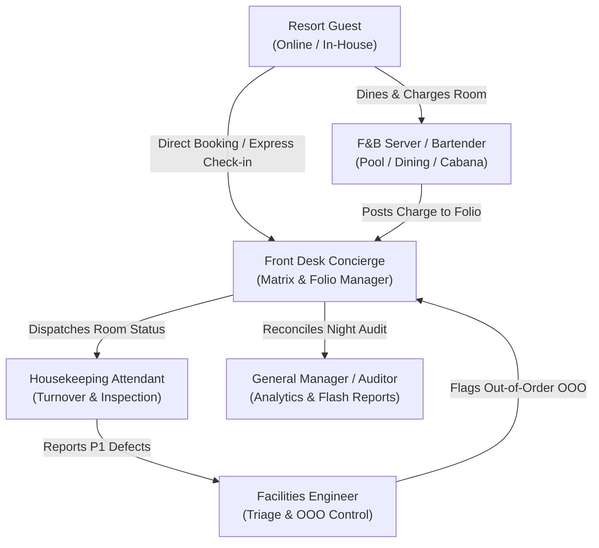

---

## 2. Flow 1: Online Guest Direct Booking & Dynamic Rate Calculation

### 2.1 Description
Captures a luxury traveler exploring accommodations, selecting dates across seasonal yield boundaries, applying dynamic rate modifiers, reserving inventory under atomic 15-minute concurrency hold, and guaranteeing deposit payment.

### 2.2 Sequence Diagram

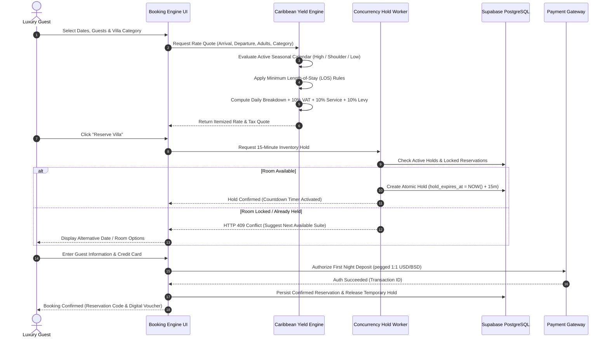

### 2.3 Operational Flowchart

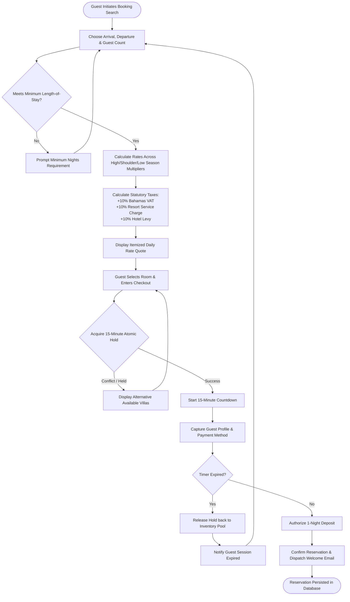

---

## 3. Flow 2: Front Desk Arrival, Passport Verification & Check-in

### 3.1 Description
Front desk check-in workflow for guests arriving at the resort, incorporating identity verification, pre-authorization, room status validation, and automated butler dispatch.

### 3.2 Sequence Diagram

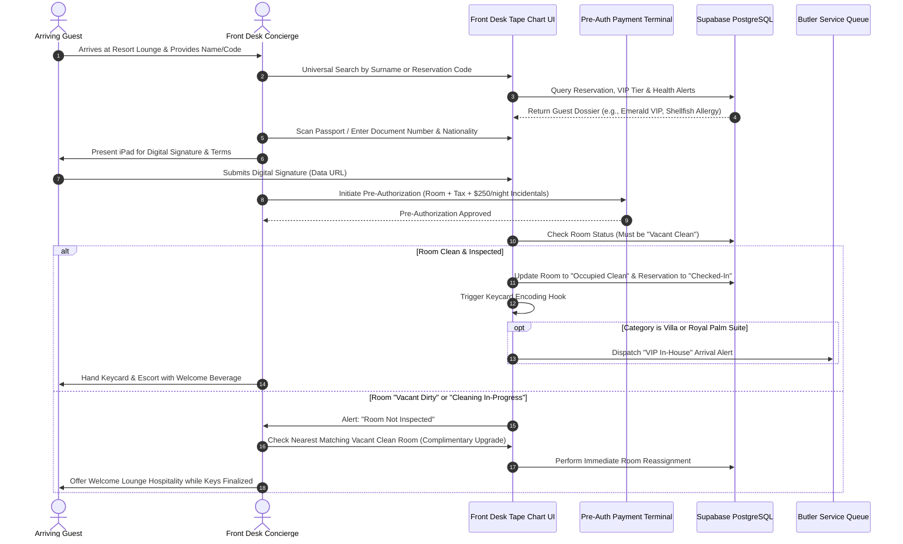

### 3.3 Operational Flowchart

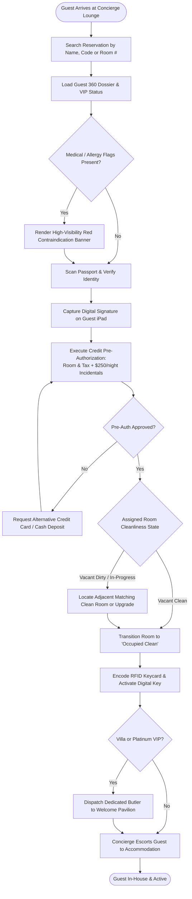

---

## 4. Flow 3: F&B Outlet Room Charge & Folio Verification

### 4.1 Description
Settlement workflow at resort food and beverage outlets (Sunset Pier, Driftwood Pool Bar, Coconut Cabana) charging meals and drinks directly to the guest room folio with surname verification.

### 4.2 Sequence Diagram

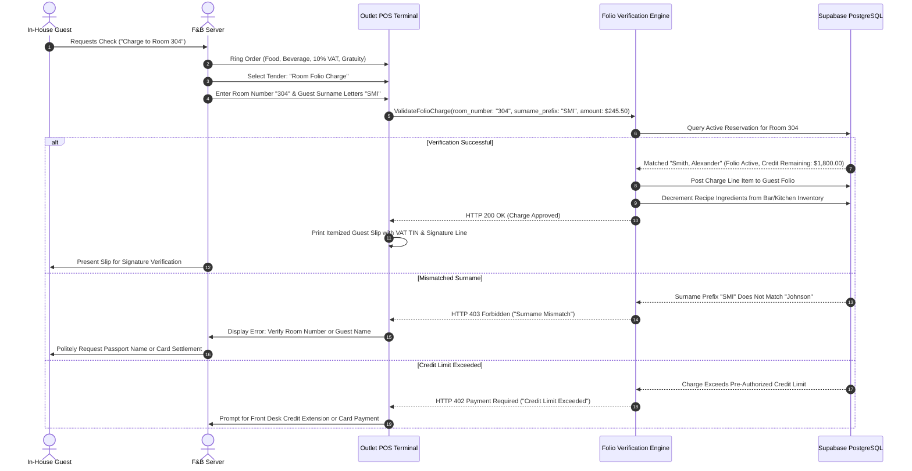

### 4.3 Operational Flowchart

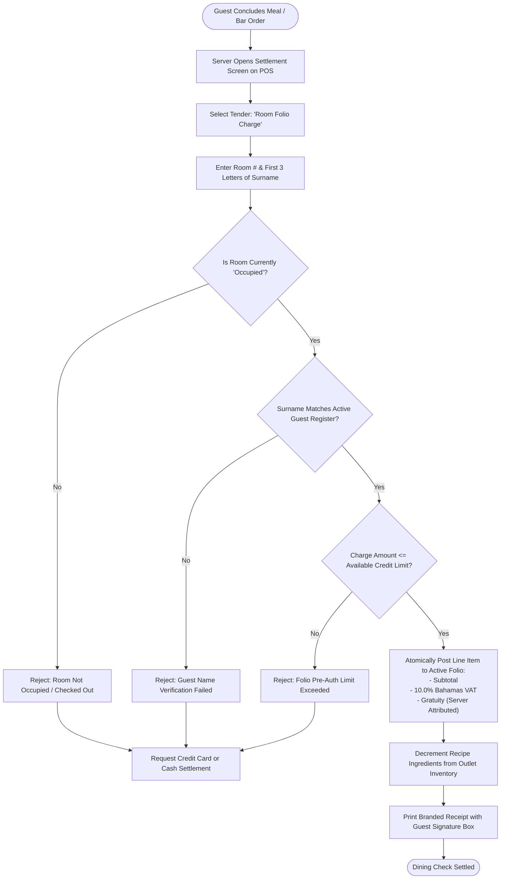

---

## 5. Flow 4: Housekeeping Turnover & Urgent Maintenance Triage

### 5.1 Description
Lifecycle of daily room turnover, departure deep cleans, and high-severity engineering defect triage that automatically transitions rooms to Out-of-Order (OOO).

### 5.2 State Transition Diagram

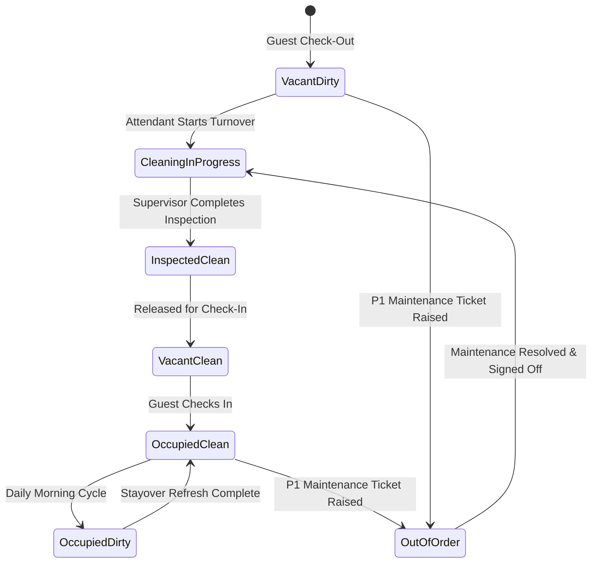

### 5.3 Maintenance Triage Sequence Diagram

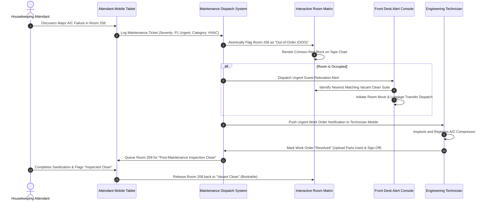

---

## 6. Flow 5: Multi-Tender Folio Settlement & Tax Invoice Checkout

### 6.1 Description
Comprehensive departure settlement at Front Desk, managing multiple tenders across USD/BSD (pegged 1:1), personal vs. corporate master billing splits, statutory tax compliance, and zero-penny leakage.

### 6.2 Mathematical Tax & Odd-Penny Splitting Logic

```
1. Master Folio Aggregation:
   Total Charges = ∑(Room Nights) + ∑(F&B Checks) + ∑(Spa/Concierge) + ∑(Incidental Goods)

2. Tax & Statutory Fee Segregation:
   - Base Lodging = $3,000.00
   - 10.0% Resort Service Charge = $300.00
   - 10.0% Bahamas Hotel Levy = $300.00
   - 10.0% Bahamas VAT on Lodging = ($3,000.00 + $300.00) × 0.100 = $330.00
   - F&B Subtotal = $500.00
   - 10.0% Bahamas VAT on F&B = $50.00
   - Gratuity Paid = $90.00
   -----------------------------------------------------------------
   Grand Total Due = $3,000 + $300 + $300 + $330 + $500 + $50 + $90 = $4,570.00

3. Odd-Penny Split-Tender Allocation (e.g., 3 Equal Split Tenders):
   - Tender 1 (Credit Card): $1,523.34 (Allocated Remainder Cent)
   - Tender 2 (Cash BSD):    $1,523.33
   - Tender 3 (Wire / USD):  $1,523.33
   - Sum Check: $1,523.34 + $1,523.33 + $1,523.33 = $4,570.00 (Zero Leakage)
```

### 6.3 Sequence Diagram

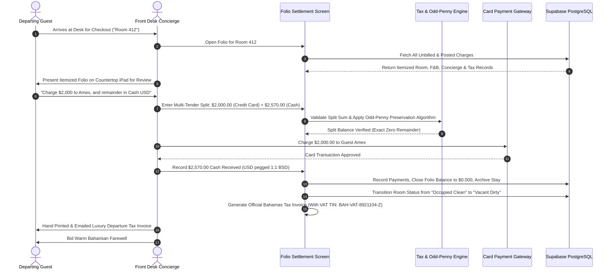

### 6.4 Operational Flowchart

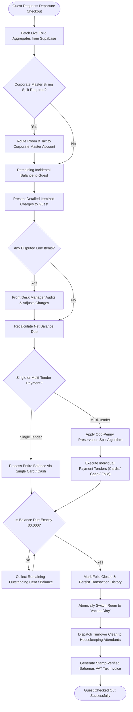

---

## 7. Operational Validation & Traceability Matrix

| Flow ID | Scenario | Primary Actor | Success Assertion | Edge Case Handled |
| :--- | :--- | :--- | :--- | :--- |
| **FL-01** | Online Direct Booking | Guest | 15-minute atomic inventory hold acquired; deposit collected | Concurrent booking conflict (HTTP 409) with alternate suggestions |
| **FL-02** | Express Front Desk Check-in | Concierge | Digital signature & ID logged; room set to `Occupied Clean` | Room uncleaned at arrival $\rightarrow$ immediate clean upgrade reassignment |
| **FL-03** | F&B Outlet POS Room Charge | Server | Charge posted to room folio in <200ms with receipt slip | Surname mismatch or credit pre-auth limit exceeded $\rightarrow$ card settlement |
| **FL-04** | Housekeeping & Urgent P1 Triage | Attendant / Tech | P1 ticket atomically switches room to `Out-of-Order (OOO)` | Occupied room P1 defect triggers immediate front-desk guest relocation |
| **FL-05** | Multi-Tender Folio Settlement | Front Desk | Folio cleared to $0.000 with Bahamas VAT TIN invoice | Fractional penny split leakage eliminated via Odd-Penny Preservation |
